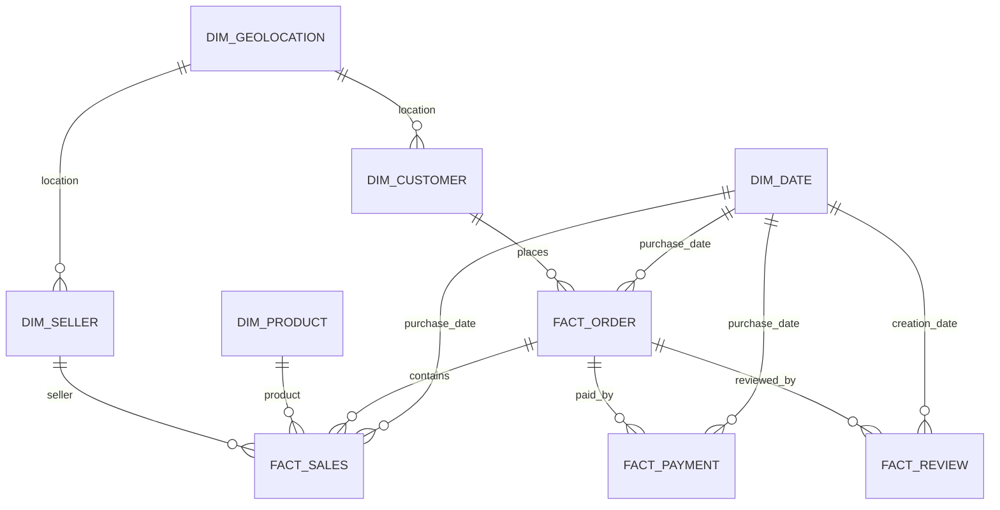

# Olist star schema

## Grain

| Tabel | Grain |
|---|---|
| `dim_customer` | Satu `customer_id` |
| `dim_seller` | Satu `seller_id` |
| `dim_product` | Satu `product_id` |
| `dim_geolocation` | Satu prefix kode pos kanonis |
| `dim_date` | Satu tanggal kalender |
| `fact_order` | Satu `order_id` |
| `fact_sales` | Satu kombinasi `order_id` dan `order_item_id` |
| `fact_payment` | Satu kombinasi `order_id` dan `payment_sequential` |
| `fact_review` | Satu `review_key` komposit |

## Aturan penggunaan

`fact_sales`, `fact_payment`, dan `fact_review` memiliki grain berbeda. Untuk laporan yang membutuhkan ketiganya, agregasikan masing-masing fakta ke tingkat pesanan terlebih dahulu atau gunakan `vw_order_summary`. Penggabungan langsung ketiga tabel dapat menggandakan nilai pembayaran, penjualan, atau jumlah ulasan.

Surrogate key bernilai `0` adalah anggota `unknown`. Nilai ini digunakan jika referensi dimensi tidak tersedia, sehingga foreign key fakta tetap valid tanpa membuat nilai sumber palsu.
