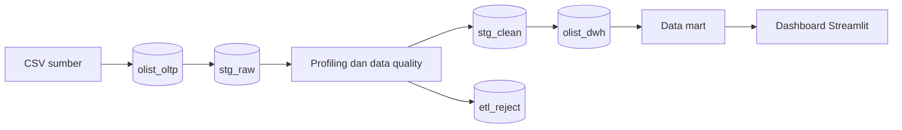

# Arsitektur dan grain

## Grain tabel fakta

| Tabel | Grain |
|---|---|
| `fact_order` | Satu order |
| `fact_sales` | Satu kombinasi order dan nomor item |
| `fact_payment` | Satu urutan pembayaran dalam order |
| `fact_review` | Satu review key komposit |
| `fact_order_event` | Satu jenis event dalam perjalanan order |

`fact_sales`, `fact_payment`, dan `fact_review` tidak boleh digabungkan langsung tanpa agregasi per `order_key`. Gunakan `vw_order_summary` bila membutuhkan ketiganya dalam satu analisis.

## Time variant

- `dim_date` menyimpan kalender.
- Fakta menyimpan beberapa role-playing date key.
- `fact_order_event` mengubah timestamp perjalanan order menjadi event analitik.
- `etl_batch` menyimpan business date, waktu mulai, waktu selesai, dan status.
- `etl_watermark` mencatat batas ekstraksi sukses terakhir.
